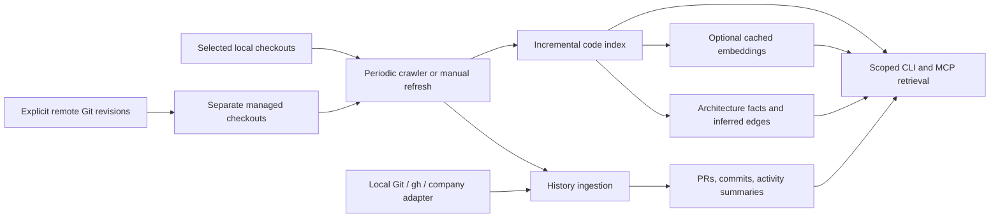

# Architecture, crawling, and efficient retrieval

New to the repository? Start with [How Context Engine fits together](ARCHITECTURE-OVERVIEW.md), a walkthrough of the components and one search through the system. This page is the technical reference for crawling and extracted retrieval.

The engine now maintains a cited structural system overview alongside code search and historical activity. These are scoped local artifacts, regenerated from accessible evidence without an LLM. They are not a validated runtime design or resolved call graph.



Each manifest has a separate SQLite store. Team and personal manifests remain separate throughout indexing, derived artifacts, and retrieval. The company integration supplies identity, credentials, repository selection, and process supervision.

## Run it

From the engine checkout, substitute your manifest and use the same explicit state path for all commands:

```sh
python3 -m context_engine --manifest examples/acme.json --state /tmp/context-demo crawl --once --no-history
python3 -m context_engine --manifest examples/acme.json --state /tmp/context-demo overview --query 'task.requested'
python3 -m context_engine --manifest examples/acme.json --state /tmp/context-demo discover 'priority' --mode symbols --max-snippet-lines 0
python3 -m context_engine --manifest examples/acme.json --state /tmp/context-demo read api tasks.py --line-start 1 --line-end 40
```

Run `crawl` without `--once` for foreground periodic operation. Defaults: code/architecture/embeddings every 300 seconds, history and activity summaries every 21600 seconds, history window six calendar months. `--no-history` disables historical collection. `--force` bypasses saved due times; use it with `--once` for an immediate refresh. `watch` remains a faster code-only polling option. Neither command installs a service. The generated VS Code tasks include a manually started crawler and an overview task; the automatic watchers remain code-only.

```json
{
  "crawler": {
    "interval": 300,
    "history_interval": 21600,
    "history": true,
    "history_provider": "auto",
    "history_months": 6,
    "max_pages": 100
  }
}
```

The crawler checkpoints each job, skips completed work until due, resumes interrupted jobs, and retries thrown failures with bounded backoff. Partial coverage uses the normal cadence. A store-wide advisory lock coordinates crawler, index, history ingestion, and watcher writers across processes. Stored timestamps describe the last run; they do not prove a process is alive. History collection rechecks the selected window and deduplicates records; it does not yet use remote incremental cursors or propagate deletion/access revocation.

## Canonical remote sources

Existing `git` and `files` sources are read in place and never fetched or checked out by the crawler. For a separately managed canonical snapshot, explicitly configure:

```json
{
  "schema_version": 1,
  "environment": "team",
  "workspace": "canonical",
  "sources": [
    {"id": "api", "type": "remote-git", "url": "https://github.com/company/api.git", "ref": "refs/heads/main"}
  ]
}
```

`crawl` fetches this ref into a configuration-scoped directory beneath state, then indexes it. Use credential-free HTTPS, `git@host:path`, or an absolute local Git repository path; credentials come from the environment. A full branch/tag ref or commit SHA is required. Managed snapshots use detached HEADs and ownership markers. Local edits, altered origins, or symlinks cause refusal rather than destructive reset. Failed access is reported and current-code retrieval withholds degraded snapshots. Other accessible sources can still be collected. Submodules and Git LFS content are not provisioned. The engine does not create a shared authenticated service.

## What the overview contains

`overview` / MCP `get_system_overview` returns repository cards, module summaries, symbol signatures, entrypoint signals, imports, route/event literals, and cited relationships. Python uses AST extraction; other language declarations and route signals use conservative heuristics. Resolvable static import candidates and shared event literals become explicitly inferred edges. A shared literal is not proof of a producer/consumer relationship. Documentation and package metadata supply descriptions when present.

Facts are cached by file content identity; unchanged files are not re-extracted. Deletions prune facts and edges. Code freshness and extractor identity gate retrieval. Citations include source, relative path, line range, content hash, and revision when available. Query terms and dependency degree prioritize the bounded map. `source` focuses a repository; cross-source edges can retain both citations within the same manifest. `node` expands a returned node, or `source:<id>`. Missing parsers and unresolved relationships remain visible as gaps.

The response includes an ETag scoped to configuration, generation, extractor, query, focus, and budget. Repeat the same request with `if_none_match` to receive a small `unchanged` result. Cache only within the same authorized scope.

## Retrieve progressively

| CLI | MCP | Use |
| --- | --- | --- |
| `overview` | `get_system_overview` | Start with a bounded map; expand a node |
| `discover` | `search_code` | Search lexical, semantic, hybrid, literal, regex, symbols, or files |
| `read` | `read_code` | Read a selected line range; optionally require the returned hash |
| `related` | `find_related` | Find similar code, not resolved references |
| `crawl --once` | `refresh_context` | Run due refresh jobs; `force` refreshes immediately |

Search filters include source, path glob, and content category (`code`, `docs`, `config`, `all`), applied before result limits. Snippets default to five lines; `max_snippet_lines: 0` returns locations/metadata only. Read defaults to 80 lines, allows up to 200 per call, and returns `next_line` when more is available. Oversized single lines produce an explicit gap rather than silently skipping content. Literal/regex search is bounded to 10000 files/16 MB and 250 matching files, with one match per file; regex runs in a subprocess with a two-second timeout. It is not exhaustive indexed regex search.

New retrieval tools pack the **entire compact JSON tool text** into a 1024–32000 UTF-8 byte ceiling (2000 default for overview/search; 4000 for reads). The legacy name `token_budget` remains, but these are bytes, not measured model tokens. Outer MCP protocol envelopes are excluded. Budget metadata reports omitted items. MCP `search_history` defaults to the same compact format; `compact: false` retains its legacy verbose response. Legacy `search_context` and `get_context_bundle` retain their existing evidence-budget behavior.

On three tiny public fixture queries, compact search preserved the selected files while reducing whole response bytes by 63.8%, 70.4%, and 73.6% against verbose legacy search. The overview used 1713 bytes under a 2000-byte limit; its unchanged response used 408. These measure payload overhead, not production token savings, relevance, or task success. Reproduce with `python3 evaluate_context.py`; see [recorded results](../evaluation/context-results-2026-09-09.json).

## Structural chunking and remaining work

Python AST excerpts and text windows work without extra packages. To use the article author's optional AST/token splitter:

```sh
python3 -m venv .venv
.venv/bin/pip install -r requirements-structure.txt
```

Add `"chunking": {"provider": "code-splitter", "max_tokens": 256}` to the manifest, then index using that interpreter. The pinned bindings support Python, Rust, Go, and Markdown; other languages retain built-in chunking. Missing or failed optional splitters fall back with a parser gap. Changing provider identity re-chunks files. The splitter's target is distinct from the serving byte budget; reconstructed whole-line excerpts can exceed the splitter target.

Still outstanding: precise multilingual definitions/references through LSP, automated instruction applicability resolution, production-scale vector/trigram indexes, calibrated semantic abstention, remote deletion/access-change propagation, and deployment into the actual company harness. See [open-source comparison](OPEN-SOURCE-COMPARISON.md) for the feature audit.
